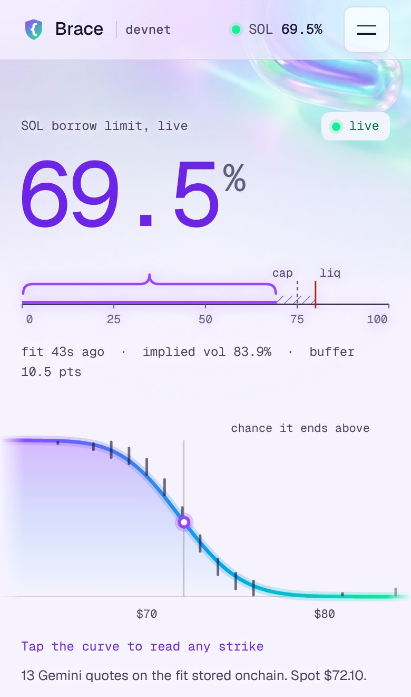
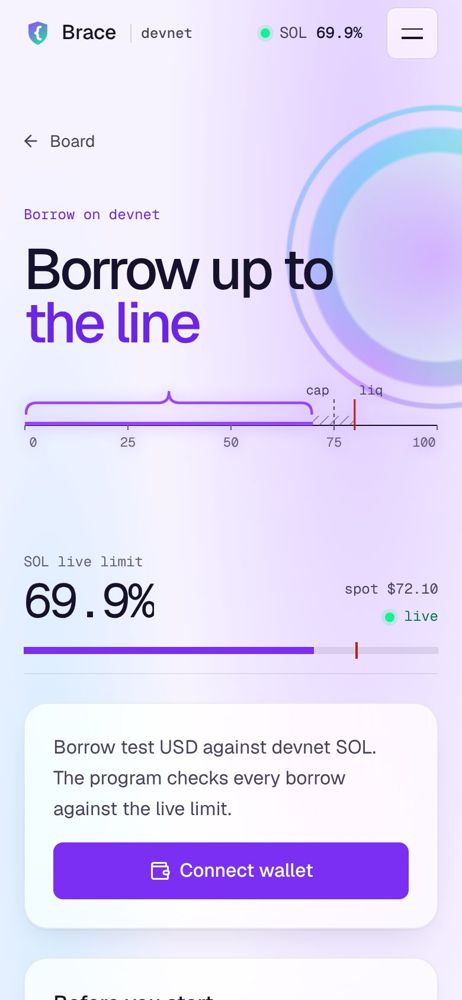
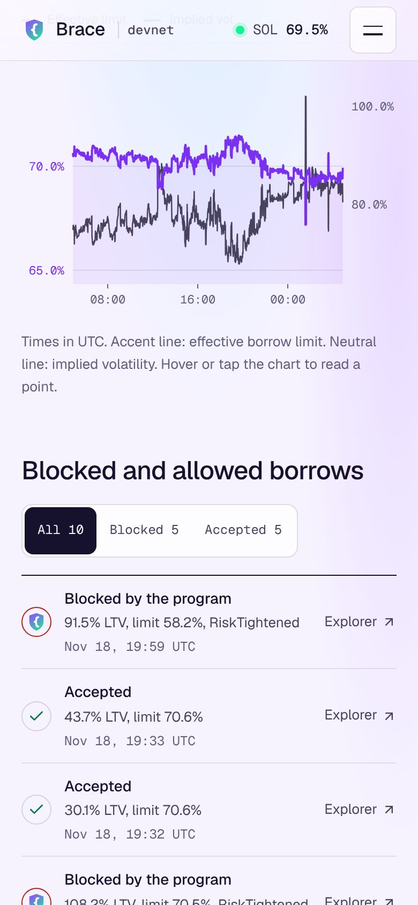
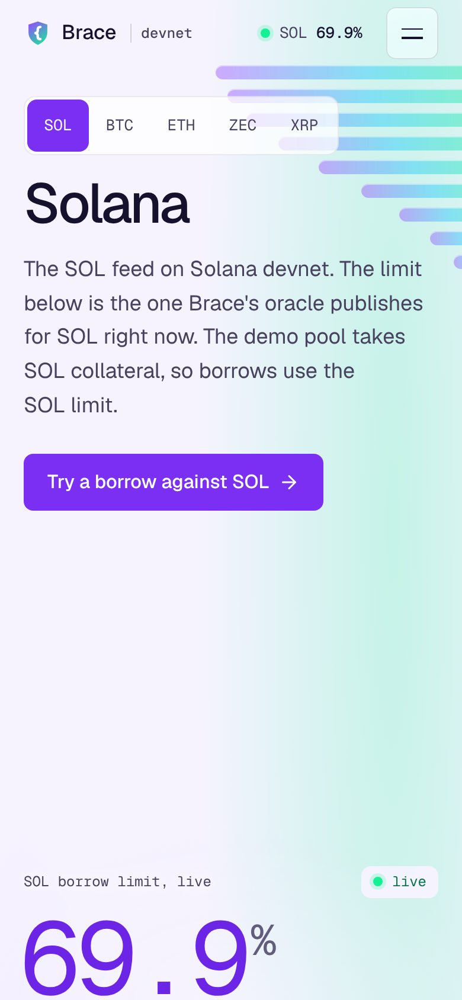
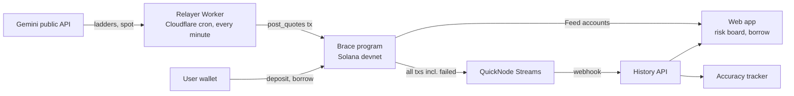

# Brace

**For judges:** open [braced.vercel.app](https://braced.vercel.app) (no wallet) and read SOL's live borrow limit. Then, with Phantom on Solana Devnet, borrow above that limit and watch the program reject it: [a verified rejected borrow](https://explorer.solana.com/tx/59uvMm48LV248sXSnvTV9wb8ZpVZmB8Q3ffiAsq3NU97wjU3wuSGD4EBSihWYpm1qZhrQNATA5rz5v1GWH6RVHnP?cluster=devnet). Steps are in [Try It](#try-it).

<p align="center">
  
</p>

**Gemini's prediction markets, turned into an onchain volatility oracle for Solana lending.**

Lending markets set loan-to-value limits by governance vote and rarely change them, so limits are still the calm-week numbers when volatility arrives. Brace reads Gemini's live "price X or above" ladders, computes implied volatility onchain on Solana, and lowers borrowing limits as soon as traders price a bigger move. Limits never go above the 75% admin-set cap, stale data only ever lowers them, and odds never liquidate anyone.

| What | Steps, time and what it needs |
|---|---|
| [Try It: the live board](#try-it) | 3 steps, no wallet. Measured: the live Gemini curve is on screen in 2.8 to 3.5 s. |
| [Try It: a real borrow](#with-a-devnet-wallet) | 4 more steps. Phantom with Testnet Mode on Solana Devnet and free devnet SOL. Not timed. |
| [Proof It's Real](#proof-its-real) | Explorer links for every claim. No wallet. |
| [More Ways to Test](#more-ways-to-test) | One command (`scripts/verify.sh`) or each suite on its own. Rust 1.89, Solana CLI and Node 20+. |
| Film of the demo | TBD-post-build: film link once it is recorded. |
| [Tracks](#tracks) and [how it was built](#built-during-ubc-2026) | DeFi & Onchain Apps, Best use of Solana, Gemini Prediction Markets, QuickNode Streams. |

## Try It

You use the real app on Solana devnet, where every token is free test money. Steps 1 to 3 need no wallet and no signup.

1. **Open [braced.vercel.app](https://braced.vercel.app).** You see **Lending limits that move before the market does**, SOL's live borrow limit, and Gemini's ladder drawn as **chance it ends above** each strike. Scroll to **Five limits, traced for 24 hours** for SOL, BTC, ETH, XRP and ZEC.
2. **Tap Try a borrow.** The borrow page shows the same **SOL live limit**, a **Connect wallet** button and a **Before you start** list.
3. **Open [History](https://braced.vercel.app/history).** You see 24 hours of SOL's limit and implied volatility, and **Blocked and allowed borrows**: each **Blocked by the program** row is a borrow Solana rejected, recorded by QuickNode Streams. If the relayer's free history store has hit its daily read limit, the page says **Live history is paused for today** and charts the last 24 hours recorded before the pause; it resets at 00:00 UTC (see [Known Limitations](#known-limitations)). Limits and borrowing are unaffected.

You just saw a borrow limit computed onchain from Gemini's odds, and the borrows it has already stopped.

Measured with Playwright Chromium at a 390 px phone viewport, cold cache, from our build machine on Nov 19, 2026 at 05:36 Lagos, 3 runs: the heading in 1.5 to 1.7 s, the Gemini curve in 2.8 to 3.5 s, the borrow page under 0.2 s after the tap, the History rows under 0.5 s. Reading time is yours.

### With a Devnet Wallet

4 steps, not timed. Open position, Deposit and each Borrow need one approval in Phantom.

1. **In Phantom, open Settings, then Developer settings,** turn **Testnet mode** on and choose **Solana Devnet**. Get free devnet SOL at [faucet.solana.com](https://faucet.solana.com).
2. **Open [braced.vercel.app/borrow](https://braced.vercel.app/borrow) in Phantom's in-app browser.** Tap **Connect wallet**, then **Open position**, then **Deposit** 0.5 SOL under **Deposit SOL**.
3. **Slide the borrow amount past the limit** until the page says **Over the live limit**. Tap **Submit anyway**, read **What Phantom shows next**, then tap **Continue in Phantom**. Phantom shows a red "Failed to simulate the results of this request" because the program refuses the borrow: tap **Confirm (unsafe)**, tick the box, then **Yes, confirm (unsafe)**. The transaction lands onchain and fails with `RiskTightened` (error 6005). A verified run at 10:23 Lagos on Nov 17, 2026 logged `brace blocked ltv=7208 limit=6954`: [rejected borrow](https://explorer.solana.com/tx/59uvMm48LV248sXSnvTV9wb8ZpVZmB8Q3ffiAsq3NU97wjU3wuSGD4EBSihWYpm1qZhrQNATA5rz5v1GWH6RVHnP?cluster=devnet).
4. **Lower the amount under the limit and tap Borrow.** It goes through. A verified run at 10:24 Lagos borrowed 8.30 test USD and logged `brace borrow ... ltv=2303 limit=6952`: [accepted borrow](https://explorer.solana.com/tx/42EzMtDmmcengifcyTXjLY2BT3K1s8XCdVMEG3usorpbGiYEL5KgFHyBpWm9PyVi3Tymjg34PKqqmeCSQeJgehSf?cluster=devnet). Both were recorded in the [Streams `/actions` feed](https://brace-relayer.ohjaye0.workers.dev/actions); the [History](https://braced.vercel.app/history) page shows the last 24 hours.

## Proof It's Real

- **Program on Solana devnet:** [`Frv6CVJKADmkM2cnBSMKgBWPvtHsfYkfye5d4vB84WyC`](https://explorer.solana.com/address/Frv6CVJKADmkM2cnBSMKgBWPvtHsfYkfye5d4vB84WyC?cluster=devnet).
- **Live posts:** a packed `post_quotes` transaction whose logs include `brace SOL conf=1 sigma_bps=8438 max_ltv=6939` (plus BTC, ETH and XRP in the same transaction): [Explorer](https://explorer.solana.com/tx/5cwQA5BzCHPZPJTDbs6bRiPX649mQr8v4vj8C2kXusPayhZk6pL5mmMC9nJtuKHqzw5ad2mhjHiFrgwNjRajcgNB?cluster=devnet). That SOL post used 40,674 compute units.
- **A borrow the program rejected**, and one it accepted, both on Nov 17, 2026 (Africa/Lagos):
  - Open position: [Explorer](https://explorer.solana.com/tx/2khAyi6PQUAYJkByPZeYw3YP2EfTwmE1eq2GHVXd6oCoG3XTa83viTdiEMByHyTVXnP7Ppijw19qiyA7vtpJDBh4?cluster=devnet) (10:22).
  - Deposit 0.5 SOL: [Explorer](https://explorer.solana.com/tx/3zSophyyijMXYDmNcQ4Bju39AyT8id8FLfGkSjZEf3yzfRd2Vix2yUb3fgZ2t68EUz2tY85thYkeVNvzc4dy4A1E?cluster=devnet) (10:23).
  - Rejected over-limit borrow, `RiskTightened` 6005, log `brace blocked ltv=7208 limit=6954`: [Explorer](https://explorer.solana.com/tx/59uvMm48LV248sXSnvTV9wb8ZpVZmB8Q3ffiAsq3NU97wjU3wuSGD4EBSihWYpm1qZhrQNATA5rz5v1GWH6RVHnP?cluster=devnet) (10:23).
  - Accepted borrow of 8.30 test USD, log `brace borrow ... ltv=2303 limit=6952`: [Explorer](https://explorer.solana.com/tx/42EzMtDmmcengifcyTXjLY2BT3K1s8XCdVMEG3usorpbGiYEL5KgFHyBpWm9PyVi3Tymjg34PKqqmeCSQeJgehSf?cluster=devnet) (10:24).
- **History from QuickNode Streams:** [https://brace-relayer.ohjaye0.workers.dev/history?asset=SOL](https://brace-relayer.ohjaye0.workers.dev/history?asset=SOL). The [History page](https://braced.vercel.app/history) charts the last 24 hours of SOL's effective limit and implied volatility from that feed, and lists blocked and allowed borrows from [`/actions`](https://brace-relayer.ohjaye0.workers.dev/actions).
- **The math works on real Gemini data.** A captured SOL ladder used as a test fixture fits onchain to 82.7% implied volatility and a 69.6% limit (`sigma_bps` 8272, `max_ltv_bps` 6960), matching an independent float reference ([`programs/brace/tests/oracle.rs`](programs/brace/tests/oracle.rs), [`src/math.rs`](programs/brace/src/math.rs) unit tests).
- **The deployed program is this repo's code.** The program dumped from devnet (`solana program dump -u devnet Frv6CVJKADmkM2cnBSMKgBWPvtHsfYkfye5d4vB84WyC deployed.so`) has the same SHA-256 as a fresh `cargo build-sbf` of `programs/brace` on main: `5ab936eca3384bd94cff3f3c6605e17832f6667a82571b60f50730091fcf2e81`, checked twice on Nov 19, 2026 (program source last changed in `3ee7c0e`).
- **Reviewed in six passes** by four separate AI reviewer sessions (not a professional audit): no critical or high findings; fixed mediums each have a reproducing test, and the open ones are listed in Known Limitations ([`docs/reviews.md`](docs/reviews.md)).
- **Accuracy (Alchin's tracker, [`tracker/`](tracker/)):** the price landed inside Brace's 1σ band about 78 to 79% of the time across every run, and inside 2σ about 96 to 97%. A perfectly calibrated band holds about 68% and 95%, so the limits run conservative, the safe side for a lender. Each forecast is a one hour band posted every minute, so consecutive forecasts overlap.

  | Run | Forecasts | 1σ | 2σ | Check it |
  |---|---|---|---|---|
  | Alchin, pull at 04:22 Lagos, Nov 19 (rows from Nov 17 04:59) | 8,303 | 79.47% | 97.21% | His tracker run; same rows feed the snapshots below |
  | Same, only non-overlapping hours | 164 | 82.32% | 97.56% | |
  | Snapshot to Nov 19 06:56 Lagos | 9,017 | 77.65% | 96.33% | [`docs/accuracy/2026-11-19/`](docs/accuracy/2026-11-19/), reproduce command inside |
  | Alchin, run at 01:17 Lagos, Nov 20 | 14,393 | 79.0% | 96.7% | His tracker run |
  | Snapshot to Nov 20 05:35 Lagos | 15,656 | 78.15% | 96.55% | [`docs/accuracy/2026-11-20/`](docs/accuracy/2026-11-20/), reproduce command inside |

  Per asset at 1σ on the Nov 20 snapshot: SOL 76.9%, BTC 70.4%, ETH 78.8%, XRP 83.4%, ZEC 81.8%. These test the 1 hour 1σ and 2σ bands; the limit itself uses a 3σ 24 hour move, which needs a longer record (24 hour results so far are preliminary because of feed gaps).

## What's New Here

**Prediction markets used as risk infrastructure for the rest of DeFi, not as another betting app.**

Forward-looking volatility feeds today usually come from options markets. Gemini already lists daily and hourly price ladders on assets the live board posts, including ZEC.

- **The math runs onchain.** The relayer posts Gemini's raw bid and ask quotes; the program does the fit with integers only (probit lookup table, least squares, square roots). The relayer never posts a volatility number, but the quotes themselves are trusted: nothing onchain proves they came from Gemini. The program bounds what a bad ladder can do: the limit is clamped between 30% and 75%, and spot must sit within 3% of the fitted median (see [Known Limitations](#known-limitations)).
- **Fail safe, not fail open.** Thin, stale or inconsistent data never loosens a limit: it holds, then steps down 2.5 points every 5 minutes. After an hour without a confident post, borrowing, withdrawing with debt and liquidation stop.
- **Odds never liquidate.** Liquidation uses only the 80% threshold set in the config.
- **Push-based history.** QuickNode Streams delivers every program transaction, including failed borrows, to the history feed without RPC polling.

## How It Compares

Sources were fetched on Nov 17, 2026. Each competitor cell is as that vendor's cited page describes the product on that date. **Not stated** means the cited page does not say.

| Product | Data source | Forward-looking? | Assets covered | Update cadence | Where the math runs | Cost and sign-in | Open source |
|---|---|---|---|---|---|---|---|
| **Brace** (this project) | Gemini public "price X or above" ladders and pubticker spots, posted onchain. Live board: [braced.vercel.app](https://braced.vercel.app). | Yes. Implied volatility from traded probabilities of price at expiry. | The live demo posts SOL, BTC, ETH, XRP and ZEC. | Relayer cron every minute. | Onchain in the Solana program. | Public Gemini market data. The board needs no wallet or signup. Borrowing uses a Solana devnet wallet. | Yes, [MIT](LICENSE). |
| [Kamino](https://docs.kamino.com/curators/markets/risk-parameters) (curator-set LTVs) | Curator-chosen risk parameters, "tuned to each asset based on its volatility profile, liquidity, and the reliability of its price oracle." Not described as a live implied-vol oracle. | Not stated as using implied volatility. `loanToValuePct` is curator-set; the liquidation threshold is separate. | Described by market class (stables, majors such as SOL/BTC/ETH, LSTs, long-tail). A complete inventory is not stated on this page. The page uses 70-80% LTV as a reference for majors. | Not stated as automatic. Parameters are configured by curators. | Not stated as an onchain volatility fit. Parameters are set by curators and then enforced by the market. | Not stated on this page. | Not stated on this page. |
| [Jupiter Lend](https://docs.jup.ag/user-docs/earn/lend/borrow/introduction) | Each vault has its own LTV. Prices come from Chainlink and Pyth, or from an exchange rate for pegged and yield-bearing assets. | Not stated. | Examples on this page include SOL (75% LTV), mSOL, JitoSOL and stables. A complete inventory is not stated. | LTV is a per-vault parameter. Position health is described as updating in real time via oracles. The cadence of LTV changes is not stated. | Not stated. | The page says the protocol does not charge additional fees on top of interest. Sign-in requirements are not stated on this page. | Not stated on this page. |
| [Gauntlet](https://www.gauntlet.xyz/resources/gauntlets-parameter-recommendation-methodology) | Agent-based simulations using market, borrower and liquidity data, then parameter recommendations. | The page describes simulations as forward-looking "what if" scenarios. It does not describe a prediction-market or options implied-vol feed. | Not stated (the page refers to protocols they service). | "Thousands of simulation instances daily." Recommendations go through manual QA. The page says there is no stable setting and these parameters are managed dynamically. | Offchain simulations. Not stated as running the simulation onchain. | Not stated on this page. | Not stated on this page. |
| [Chaos Labs](https://chaoslabs.xyz/posts/a-ux-framework-for-onchain-lending-products) | Risk Oracles that "dynamically adjust these parameters (e.g., LTVs, caps, rate slopes)" within "governance-defined bounds." The page does not name a market-data vendor. | Not stated as implied volatility. Described as real-time, responsive risk-parameter adjustment. | Not stated on this page. | "Dynamically adjust." The exact interval is not stated. | Not stated on this page. | Not stated on this page. | Not stated on this page. |
| [Chainlink Rate and Volatility Feeds](https://docs.chain.link/data-feeds/rates-feeds) | Realized volatility from the same data providers used in Chainlink price feeds, with prices sampled every 10 minutes. The docs page states that realized volatility is not implied volatility. A [June 12, 2023 Chainlink blog](https://chain.link/blog/volatility-oracles) describes implied volatility via Chainlink Functions from a provider API, not as an aggregated Data Feed. | Realized volatility feeds: no (historical price movement). Implied volatility via Functions: yes, as that 2023 blog describes it, but not as a standard aggregated feed on the current Rate and Volatility Feeds page. | Not stated on the overview. Inventory is on the [feed addresses](https://docs.chain.link/data-feeds/rates-feeds/addresses) page, which does not inline the list in its documentation index. | "onchain values are updated when the feed heartbeat or deviation threshold is met." Sampling is every 10 minutes. Per-feed heartbeat and deviation are on the addresses page. | Offchain computation, then written onchain as a Data Feed. | Not stated on the overview page. | Not stated on this page. |
| [Block Scholes](https://docs.blockscholes.com/) | Options-derived implied volatility surfaces (IV by strike, delta and moneyness, a BSIV index, calibrated SVI parameters) plus broader market data, via the [REST API](https://docs.blockscholes.com/data-access/rest-api). | Yes. Implied volatility. | "Digital asset data." A specific coin list is not stated on the getting-started or REST API overview pages. | REST for historical and recent data; WebSocket for real-time streaming. An exact interval is not stated on these pages. | Offchain analytics API. The getting-started page also describes on-chain oracle delivery through push and pull models. | REST requests require an `X-API-Key`. Self-service plans and a free trial API key are offered at console.blockscholes.com. | Not stated on these pages. |
| [Pyth price feeds](https://docs.pyth.network/price-feeds/best-practices) | Aggregated price plus a confidence interval (the page's example is $50000 ± $10). | No. Confidence is about current price uncertainty, not implied volatility. | Not stated on this best-practices page. | Not stated as a fixed interval on this page. Freshness and staleness are described as integrator-enforced. | Onchain read of a price and confidence interval. This is not a volatility fit. | Not stated on this page. | Not stated on this page. |

**Where Brace stands out**

- **The volatility number is computed onchain** from raw Gemini quotes, so the relayer never posts a sigma. The quotes themselves are still trusted (see [Known Limitations](#known-limitations)).
- Limits move from forward-looking implied vol, including on assets the live board already posts such as ZEC, not only from a governance vote or from backward-looking realized vol.
- Thin or stale data never loosens a limit. After an hour without a confident post, borrowing pauses.
- Odds never liquidate anyone. Liquidation uses only the 80% threshold set in the config. QuickNode Streams records rejected borrows as well as accepted ones (see the rejected transaction above).

**Where others are stronger.** Kamino and Jupiter Lend are production lending markets with deep liquidity and established oracles. Gauntlet and Chaos Labs have long-running parameter-management practice and, in Chaos's description, Risk Oracles that can move LTVs inside governance bounds. Chainlink already ships onchain realized-volatility feeds, and Block Scholes already sells institutional implied-volatility surfaces (an API key is required). Brace is a devnet demo. Its edge is public prediction-market implied vol, computed onchain, and wired into a borrow limit the program actually enforces.

## Tracks

| Track | What fits | Where to check |
|---|---|---|
| DeFi & Onchain Apps | A lending risk primitive plus a working pool that enforces it | [`instructions/borrow.rs`](programs/brace/src/instructions/borrow.rs), [Try It](#with-a-devnet-wallet) wallet steps 3 and 4 |
| Best use of Solana | Volatility math onchain in an Anchor program on devnet; a verified SOL `post_quotes` used 40,674 compute units | [`src/math.rs`](programs/brace/src/math.rs), [`instructions/post_quotes.rs`](programs/brace/src/instructions/post_quotes.rs), [the packed post](https://explorer.solana.com/tx/5cwQA5BzCHPZPJTDbs6bRiPX649mQr8v4vj8C2kXusPayhZk6pL5mmMC9nJtuKHqzw5ad2mhjHiFrgwNjRajcgNB?cluster=devnet) |
| Gemini Prediction Markets | Gemini's live ladders and Gemini's spot price are the only inputs to the oracle | [`worker/src/`](worker/src), [How Gemini is used](#how-the-sponsor-tech-is-used) |
| QuickNode Streams | Stream `brace-program` on Solana devnet, filtered to the program id, delivers every successful and failed Brace transaction to the Worker `/streams` webhook. That feed powers `/history`, `/actions` and the History page, and is the input for Alchin's accuracy tracker, measured in [Proof It's Real](#proof-its-real). | [`worker/filters/brace-program.js`](worker/filters/brace-program.js), [live `/history`](https://brace-relayer.ohjaye0.workers.dev/history?asset=SOL) |

## What Works Today

| Piece | State |
|---|---|
| Brace program (oracle, limits, pool, liquidation) | Live on Solana devnet at the address above. 52/52 Rust tests passed on Nov 19, 2026. |
| Relayer Worker (Cloudflare, every minute) | Live at [brace-relayer.ohjaye0.workers.dev](https://brace-relayer.ohjaye0.workers.dev/health). 117/117 worker tests passed on main on Nov 19, 2026. The live Worker runs an earlier build: the forged-history fix (audit pass 6, M3) and the backup RPC (PR #4) are on main and deploy next. |
| Keyed backup RPC for the relayer (PR #4) | In code on main and covered by the worker tests; not yet deployed to the live Worker. |
| Streams sink and `/history` API | Live, except when the free D1 read limit runs out (see [Known Limitations](#known-limitations)). `/history?asset=SOL` is oldest-first. `/actions` has recorded the verified deposit, blocked borrow and accepted borrow. Bad input gets a 400 with a plain error; responses are capped at 10,000 rows (page forward with `since`). |
| Web app (risk board, borrow flow, history) | Live at [braced.vercel.app](https://braced.vercel.app). 108/108 app tests passed on main on Nov 19, 2026. The board and History read the relayer through the app's cached `/api/history` and `/api/actions` routes. |
| Accuracy tracker (Python, [`tracker/`](tracker/)) | Running. Polls `/history` every 5 minutes, fetching only new rows after the first pull. Latest: 1σ 78.15% and 2σ 96.55% across 15,656 one hour forecasts (Nov 20 snapshot; see [Proof It's Real](#proof-its-real)). 10/10 tracker tests pass (`python3 tracker/test_tracker.py`). |

## More Ways to Test

Quickest first. None needs a wallet.

<details><summary><strong>1. Live checks only (a few seconds; bash, curl and python3)</strong></summary>

```bash
scripts/verify.sh --live
```

Checks the app returns 200, the relayer is healthy and all five feeds posted in the last 2 minutes, then prints `verify: all checks passed`. Without bash, the same data is public: `curl https://brace-relayer.ohjaye0.workers.dev/health`.

</details>

<details><summary><strong>2. One command for everything (about 15 minutes from cold; Rust 1.89, Solana CLI with cargo build-sbf, Node 20+)</strong></summary>

```bash
scripts/verify.sh
```

Builds the program, runs the Rust, worker and app suites with type checks, builds the app, then runs the live checks. It stops at the first failure. The fuzz run alone took 48 to 80 s on Nov 19, 2026, depending on the machine. If the history store is paused, the last line says so instead of `all checks passed`.

</details>

<details><summary><strong>3. Each suite on its own (same tools as 2)</strong></summary>

```bash
cargo build-sbf --manifest-path programs/brace/Cargo.toml && cargo test -p brace
(cd worker && npm ci && npx vitest run)
(cd app && npm ci && npx vitest run && npm run build)
```

Use `cargo build-sbf`, not `anchor build`, in a fresh clone: `anchor build` creates a new program keypair and rewrites `declare_id`, and then the program id test fails on purpose.

Expected: 52 Rust tests (15 math, 12 adversarial, 1 fuzz run of 3,000 random actions, 12 oracle, 9 pool, 3 relayer encoding), from a fresh run on Nov 19, 2026; 117 worker tests and 108 app tests, re-run on main on Nov 19, 2026.

</details>

## Screenshots

Real captures of the live site on a 390 px phone viewport, Nov 20, 2026, 06:00 Lagos. Devnet data, test money.

<p align="center">
  
  
  
</p>

## How the Sponsor Tech Is Used

**Gemini Prediction Markets API**
- `GET /v1/prediction-markets/events?status=active&limit=200&category=crypto`: the Worker picks, per asset, the earliest-expiring "above" ladder between 15 minutes and 72 hours out with at least 4 two-sided quotes, and sends up to 16 strikes with bid and ask in basis points.
- `GET /v1/pubticker/{solusd,…}`: spot price, checked onchain against the ladder's implied median (must be within 3%).
- Trading is US-only, so Brace uses public market data only.

**Solana**
- Anchor 1.2.2 program, PDAs for config, per-asset feeds, pool, positions and a test USD mint; SPL Token for the test USD.
- `post_quotes` fits the ladder onchain; `borrow` and `withdraw` check the live limit; failed borrows log `brace blocked ltv=… limit=…`.

**QuickNode Streams**
- Stream name `brace-program`, Solana devnet, **Block** dataset, filtered to program `Frv6CVJKADmkM2cnBSMKgBWPvtHsfYkfye5d4vB84WyC`.
- The filter in [`worker/filters/brace-program.js`](worker/filters/brace-program.js) keeps successful and failed transactions that touch the program, and skips empty blocks.
- Destination: the relayer Worker webhook at `/streams`. The Worker stores rows in D1 and serves `GET /history?asset=SOL` (oldest-first; `sigma_annual` and `effective_ltv` are 0-1 ratios) and `GET /actions` (`ltv` and `limit` are basis points; `ok` is a boolean).
- Why Streams: a rejected borrow changes no account, so reading program state can never show it. The Block dataset includes failed transactions with their logs, so the `brace blocked ltv=… limit=…` line is captured as it happens, without polling an RPC.

## How It Works



<details><summary><strong>The math, in short</strong></summary>

Each Gemini contract "price ≥ K at expiry" trades at a probability. Under a lognormal model, z = probit(P) is linear in x = ln(K/K_ref) with slope −1/(σ√T).

1. Keep quotes with both sides, spread ≤ 15 cents, mid between 3% and 97%; skip strikes more than 15% from the middle strike.
2. Least-squares fit gives σ√T and the implied median. The strikes must span at least 0.5%, and σ must be at least 5%.
3. Move over 24 hours: s = σ√T·√(24h/T). Limit = 80% × (1 − 3s), clamped between 30% and the 75% admin-set cap.
4. Stale data: hold the last limit for 5 minutes, then step down 2.5 points every 5 minutes, never below 50% (or the last limit if lower). After an hour without a confident post, borrowing and liquidation pause.

</details>

### Economic Design and Risk Assumptions

- **Collateral and debt.** Users deposit devnet SOL and borrow a test USD token (6 decimals) minted by the pool. Collateral is valued at Gemini's SOL spot price. Interest is 0%: this demonstrates the risk limit, not a full market.
- **Borrow limit.** `limit = 80% x (1 - 3 x s)`, where `s` is the 24-hour move implied by Gemini's ladder. It is clamped between 30% and a 75% admin-set cap, so the market moves a limit only inside that band and never above the 75% cap the admin set.
- **Liquidation.** At 80% LTV, a threshold set in the config (an admin parameter), never driven by odds. A liquidator repays the full debt and receives SOL worth the debt plus a 5% bonus, capped at the position's collateral.
- **Assumptions.** Price at expiry is roughly lognormal, so the ladder's probabilities fit a straight line after a probit transform. Three 24-hour standard deviations is the safety margin. Gemini quotes are thin, so a post counts only with at least 3 two-sided quotes, spreads of 15 cents or less, expiry between 15 minutes and 72 hours, and spot within 3% of the ladder's implied median.
- **When the assumptions fail.** Unconfident or stale data holds the last limit for 5 minutes, then steps it down 2.5 points every 5 minutes to a 50% floor (or the last limit, if lower), and pauses borrowing and liquidation after an hour. The relayer is trusted to post real quotes (see Known Limitations).

## Security

Reviewed in six passes (correctness, access control, financial logic, adversarial cases, an independent final pass, and a fresh audit on Nov 19 that reproduced each finding with a test). No critical or high findings. Every medium finding from passes 1 to 5 was fixed with a test that reproduces it, except the `initialize` front run, which the deploy script handles. Pass 6 found three mediums: the forged-history one is fixed on main and reaches the live Worker on its next deploy, and the two about liquidation using an old spot price are accepted for now and listed below. Accepted low findings are listed in `docs/reviews.md`. Full log: [`docs/reviews.md`](docs/reviews.md).

### Known Limitations

**Trust and control**
- **The relayer is a single trusted key** for quotes and the spot price; nothing onchain proves the quotes came from Gemini, and there is no quorum or second source. Mitigations: spot only moves on confident posts and must sit within 3% of the ladder's implied median, and every limit stays between 30% and 75%. Thin ladders (3 two-sided quotes, spreads up to 15 cents) can still pull the fitted volatility down, inside that band.
- **One admin key, no timelock.** The admin (`FncbMM…SvdM` on devnet) can change the 75% cap, the 80% liquidation threshold and the other parameters at any time with `set_params`. Odds never trigger a liquidation, but a lower threshold set by the admin would. Production needs a multisig and a timelock.
- **`initialize` can be front-run** between deploy and setup. Deploy, initialize and pool setup run back to back from one script, and the stored admin is checked afterwards.

**Prices and liquidation**
- **Collateral can be priced with a spot up to an hour old.** Spot only updates on confident posts. Borrows meanwhile face a limit that decays toward the 50% stale floor. In a crash where Gemini's ladder lags spot by more than 3%, liquidation runs on the pre-crash price; after a dip, a healthy position can be liquidated on the old dip price. An hour after the last confident post, `liquidate` fails with `StalePrice`, so positions can build bad debt. That is the cost of failing safe; the fix is a separate, shorter freshness clock for spot (audit pass 6, M1 and M2).
- **Liquidation repays the full debt only, and there is no write-off.** The liquidator gets SOL worth the debt plus 5%, capped at the collateral, so above about 95% LTV the bonus shrinks and above 100% liquidating loses money.
- **Rounding can loosen a limit slightly.** Midpoints snap to 50 bps steps before the fit, so on steep or narrow ladders the limit can be up to about 1.5 points looser than a floating point fit, still capped at 75%.

**Demo scope**
- **Devnet only, 0% interest, test USD with no value.** This is a risk-limit demo, not a full lending market. Gemini liquidity is thin: quotes exist, trades are rare, which is why confidence scoring and fail-safe staleness exist.
- **History can pause; limits cannot.** The relayer stores Streams rows in Cloudflare D1 on the free plan, which has a daily read limit. When it runs out, the relayer's `/history` and `/actions` answer 503 until 00:00 UTC. The History page then says **Live history is paused for today** and charts a saved copy of the last 24 hours recorded before the pause. Onchain posting, the board's live limits and borrowing are unaffected.
- **Phantom simulation of an over-limit borrow.** Phantom simulates before it signs, and the program refuses an over-limit borrow, so Phantom shows "Failed to simulate the results of this request". The user has to confirm past that warning for the rejected transaction to land onchain; the borrow page explains each tap first. Phantom also shows a new-domain notice for any site it has not reviewed yet.

<details><summary><strong>Repository</strong></summary>

| Path | What |
|---|---|
| `programs/brace/src/` | Anchor program: math, state, instructions |
| `programs/brace/tests/` | LiteSVM tests: oracle, pool, adversarial, fuzz invariants, relayer encoding |
| `worker/` | Cloudflare relayer Worker (TypeScript), Streams sink, and tests |
| `app/` | Next.js risk board, borrow flow, and history page |
| `scripts/devnet-setup.mjs` | Deploy-time setup: initialize, pool, admin check |
| `scripts/verify.sh` | One-command check: build, every test suite, app build, live relayer health |
| `docs/` | Spec, plan, reviews, research, event rules, progress log |

</details>

## Built During UBC 2026

**A new project, written entirely inside the hackathon window (hacking opened Thu Nov 12, 6:00 PM CST).**

- First commit: `a71e7ef`, 2026-11-15 23:14 Lagos (16:14 CST). No earlier code, template or boilerplate beyond `anchor init`. Check: `git log --reverse --format='%h %ad %s' --date=iso | head -3`.
- Code, tests and docs were written with AI coding assistants (Claude and Grok), directed by Oh-Jay, who made the product decisions and handles every wallet and account step. Each task was gated on its tests before it was committed; there is no CI.
- Runtime: Anchor 1.2.2 (`anchor-lang`, `anchor-spl` with SPL Token), `@solana/web3.js` 1.99.0, Next.js 15.5.29, React 19.3.1, `@vercel/analytics` 2.0.1.
- Development: LiteSVM 0.15.0, Vitest 5.1.0 (app and worker), TypeScript 5.9.3, Wrangler 4.163.0.
- Services: Gemini Prediction Markets public API, Solana devnet, Cloudflare Workers, QuickNode Streams, Vercel.
- Team: Oh-Jay led development; Alchin Daryabarijavad (co-builder and presenter) built the forecast validation and analytics tracker; Omar Dosuyev led the presentation.
- Event rules answered ([`docs/event.md`](docs/event.md)): FAQ 04 asks for a public repo, a working deployed app, a 2 to 3 minute video and a README with technical docs; FAQ 07 allows AI tools, and the AI use above is disclosed anyway.
- The live site and relayer stay up through judging and after.

<details><summary><strong>What was built each day (from the commit log, Lagos time)</strong></summary>

| Day | Built |
|---|---|
| Sun Nov 15 | README, event rules, research and the Brace brief |
| Mon Nov 16 | Spec and plan, Anchor workspace, onchain implied volatility math, oracle feed and quote posting, demo lending pool, fuzz and invariant suite, first review fixes |
| Tue Nov 17 | Review pass 5 fixes, Cloudflare relayer Worker, Streams sink and history API, devnet deploy, risk board, borrow flow, history page, verify script, MIT licence |
| Wed Nov 18 | Repo hygiene, Alchin's forecast validation tracker, site redesign, relayer D1 outage fix, Phantom borrow proof, new logo and share card |
| Thu Nov 19 | Fresh test counts, privacy page, web analytics, rate limits, tablet header fix, keyed backup RPC (PR #4), ship check, cached history proxy, audit pass 6 (independent security audit, two cold judge runs, claims audit) and its fixes, security headers, tracker polling fix |
| Fri Nov 20 | Nov 20 accuracy snapshot, refreshed History fallback, team names, retaken screenshots, this README pass |

Check: `git log --reverse --format='%h %ad %s' --date=iso`.

</details>

## License

[MIT](LICENSE).
